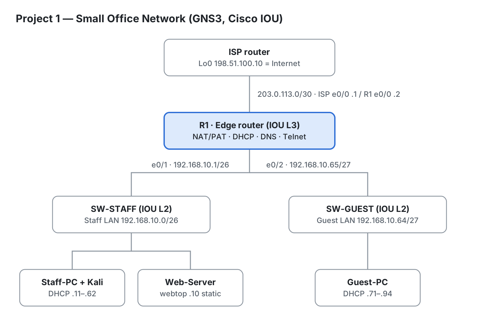

# Project 1 — Small Office Network

A small-office network built in **GNS3** with **Cisco IOU**: one edge router serves two LANs (Staff and Guest), hands out addresses with DHCP, resolves internal names with DNS, and shares one public IP through NAT/PAT.

Part of my [Network Portfolio Lab Series](../README.md) — Project 1 of 8.

## Scenario

An office has about 50 staff devices and about 20 guest Wi-Fi devices, with one ISP link. The goal is to:

- split one /24 into right-sized subnets with VLSM so no address space is wasted
- give every client an address automatically (DHCP)
- resolve internal names such as `www.lab.local` (DNS)
- let both LANs reach the Internet through one public IP (PAT)
- manage the router remotely with local user authentication

## Topology



| Node | GNS3 template | Role |
|---|---|---|
| ISP | Cisco IOU L3 15.x | Simulated ISP; Loopback0 acts as an Internet host |
| R1 | Cisco IOU L3 15.x | Edge router: gateway, DHCP, DNS, NAT/PAT |
| SW-STAFF, SW-GUEST | Cisco IOU L2 15.x | Access switches |
| Staff-PC, Guest-PC | VPCS | DHCP and ping clients |
| Staff-Kali | kali-linux | DNS, Telnet and web tests |
| Web-Server | webtop-u22 | Internal web server, static IP |

## IP Plan (VLSM from 192.168.10.0/24)

| Subnet | Hosts needed | Network | Gateway | Usable range | DHCP pool |
|---|---|---|---|---|---|
| Staff | ~50 | 192.168.10.0/26 | .1 | .1 – .62 | .11 – .62 |
| Guest | ~20 | 192.168.10.64/27 | .65 | .65 – .94 | .71 – .94 |
| WAN | 2 | 203.0.113.0/30 | ISP .1 | .1 – .2 | static |
| Reserved | — | 192.168.10.96 – .255 | — | — | future projects |

| Device | Interface | Address |
|---|---|---|
| ISP | e0/0 | 203.0.113.1/30 |
| ISP | Loopback0 | 198.51.100.10/32 |
| R1 | e0/0 (NAT outside) | 203.0.113.2/30 |
| R1 | e0/1 (NAT inside, Staff) | 192.168.10.1/26 |
| R1 | e0/2 (NAT inside, Guest) | 192.168.10.65/27 |
| Web-Server | eth0 | 192.168.10.10/26 |

## Configuration

Full configs are in [`configs/`](configs/); host setup is in [`hosts/`](hosts/).

| Feature | Key commands on R1 |
|---|---|
| Default route | `ip route 0.0.0.0 0.0.0.0 203.0.113.1` |
| DHCP | `ip dhcp excluded-address …`, pools `STAFF` and `GUEST` |
| NAT/PAT | `access-list 1 permit 192.168.10.0 0.0.0.127` + `ip nat inside source list 1 interface e0/0 overload` |
| DNS | `ip dns server`, `ip host www.lab.local 192.168.10.10` |
| Management | local user `admin`, `login local` on console and VTY |

One wildcard, `0.0.0.127`, covers both LANs (192.168.10.0 – .127), so a single ACL line feeds the PAT rule.

The ISP router has **no route back** to 192.168.10.0/24. Replies still arrive because R1 translates every LAN source to 203.0.113.2 — this is the clearest proof that NAT is working.

## Verification

Full test plan: [`tests/test-plan.md`](tests/test-plan.md)

| # | Test | Expected | Result |
|---|---|---|---|
| 1 | DHCP lease | Staff .11+, Guest .71+ | |
| 2 | Gateway reachability | Replies | |
| 3 | Inter-subnet | Replies (ACL added in Project 2) | |
| 4 | DNS `www.lab.local` | 192.168.10.10 | |
| 5 | Ping/traceroute 198.51.100.10 | Replies via .1 → 203.0.113.1 | |
| 6 | `show ip nat translations` | 192.168.10.x → 203.0.113.2 | |
| 7 | Telnet to R1 | Local user login | |
| 8 | `curl http://www.lab.local` | `Project 1 web server` | |

### Packet captures

- `evidence/dhcp-dora.pcapng` — full DHCP Discover → Offer → Request → Ack on the Staff LAN
- `evidence/nat-wan.pcapng` — ICMP on the WAN link with source 203.0.113.2, never 192.168.10.x

## Troubleshooting exercises

| Fault injected | Symptom | Root cause |
|---|---|---|
| Removed `ip nat inside` from e0/2 | Guest cannot reach the Internet; Staff can | Guest traffic no longer matches the PAT rule |
| Wrong `default-router` in pool GUEST | Guest gets an IP but cannot leave its subnet | Clients send off-subnet traffic to a non-existent gateway |

## Limitations

- **No SSH.** The IOU image `i86bi-linux-l3-p-15.0b` is IP Base and has no crypto feature set. I also tested a Cisco 2691 (12.3 ENTSERVICESK9), but it only offers SSH 1.5, which is insecure and rejected by modern OpenSSH clients. Telnet is used **in this lab only**; a production network must use SSHv2.
- No VLANs or ACLs yet — Guest can reach Staff. Both are added in Project 2.
- Passwords in `configs/` are replaced with `<PASSWORD>`.

## What I learned

<!-- Write 3–4 points in your own words, for example:
- Why subnets are allocated largest-first in VLSM
- How PAT lets many hosts share one public IP, and why the ISP never needs a route to private space
- How to read the DHCP DORA exchange in Wireshark
- How to diagnose a lab limitation (missing crypto) and document the trade-off
-->

## Repository layout

```
project-01-small-office/
├── README.md
├── topology.png / topology.svg
├── configs/        ISP, R1, SW-STAFF, SW-GUEST (passwords redacted)
├── hosts/          Web-Server, Staff-Kali, VPCS commands
├── tests/          test plan
└── evidence/       show outputs, screenshots, pcaps
```
